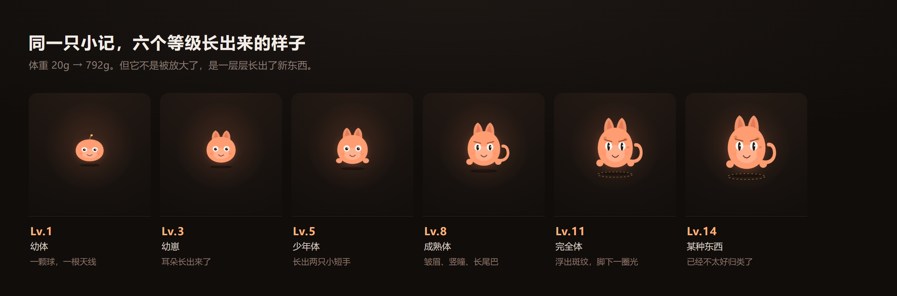

# 小记 · 一只有记性的电子宠物

> 喂它说话，它会长大、会记事，也会记仇。



**源码**：[`index.html`](./index.html) · [`src/`](./src) — [brain.js](./src/brain.js) 人格与提示词 · [state.js](./src/state.js) 数值与存档 · [ui.js](./src/ui.js) 渲染与交互 · [main.js](./src/main.js) 流程 · [cloud.js](./src/cloud.js) 模型调用 · [`assets/style.css`](./assets/style.css) 全部动画

**文档**：[图文教程](./docs/图文教程.md) · [创作说明](./docs/创作说明.md)

本地预览：一行命令即可启动（见下文「本地跑起来」），不需要装依赖、不需要 API Key。

---

## 这是什么

「小记」不是一个聊天机器人。它是一个**会被你养出来的东西**。

你在输入框里打字，就是在喂它。它不会回答问题、不会提供帮助、不会说"有什么可以帮你的"。它只会：

- **记事**：把你说的关键信息压成"记忆碎片"存起来，下次聊天自己翻出来
- **翻旧账**：你说过要早睡、答应过请它吃饭，它都记着，而且会当面提
- **记仇**：进"记仇簿"的事，道歉不算数。它当场开价，你每道歉一次就加一次价，只有东西真给了才翻篇
- **真喂饭**：底下有个食盆，小鱼干、猫条、罐头、三文鱼都能喂进去。每只口味不同、会吃撑、会对食物发表意见——**它开的价要是"一顿罐头"，你真喂一罐，那笔账当场划掉**
- **上厕所**：吃进去的总得还回来。它会在脚边拉，地上堆着不收拾会掉心情、招味儿，堆到第三坨还放了一晚上，它就把这事记进记仇簿；点一下收拾干净，它才别扭地开口
- **长大**：每喂一次长体重、升等级，形象会**长出新的部件**——Lv.3 耳朵、Lv.5 小手、Lv.6 尾巴、Lv.8 皱眉竖瞳、Lv.10 斑纹、Lv.11 脚下一圈光环
- **变形**：你说话的方式会推着它的性格漂移（毒舌↔温柔 / 混沌↔理智 / 社恐↔社牛），长出一个只属于你的称号
- **闹脾气**：几天不理它，回来它会变冷淡，开口第一句就不太客气

---

## 怎么玩

1. 打开网页，给它起个名字
2. 随便说点什么（真的随便，吐槽、报菜名、说今天干了什么）
3. 注意看它回完话之后**弹出来的小圆片**——那是它刚刚记下的东西
4. 点输入框左边的碗，喂点真的：罐头、小鱼干、猫条、三文鱼，还有一坨不知道是什么的东西
5. 过一会儿它会在脚边拉。点一下地上的东西就能收拾，收拾干净了它才肯说句话
6. 点右上角「档案」，能看见它的性格条、肚子饱不饱、口味、地上几坨、记仇簿和全部记忆
7. 关掉页面，第二天再来。它会先开口

喂了 6 顿之后的真实样本：

```
你：我今天面试挂了，好烦
它：面试……是什么，能吃吗。

你：我保证明天一定早睡
它：(打哈欠) 你昨天也这么说的吧……反正我记着呢。
    ↳ 记仇 · 主人答应早睡却没做到

你：今天被老板骂了，气死
它：被骂了啊……那你昨天说早睡，八成又没影。
```

点了食盆里的罐头：

```
它：（舔舔嘴）一口就没了？你喂猫呢。
    ↳ 吃掉罐头 · +49 经验
    ↳ 赔清了 · 两顿罐头
```

喂进去的是真的东西：经验、饱腹、口味反应都在这一口里结算，谈不拢的那笔账也跟着划掉了。

---

## 它是怎么做的

整体是**纯前端单页 + 一个云端大脑**，没有自建服务器。

```
你打字
  ├─→ ① 流式生成回复（把记忆、性格、心情、离线时长全塞进 system prompt）
  └─→ ② 异步再调一次模型，把这一轮压成结构化状态
          输出 { memories, traits, mood }
          → 写进存档 → 变成界面上那颗小圆片
```

几个关键设计：

**1. 记忆不是聊天记录**
不保存全文对话，只保存模型抽取出的短句（"主人养了只胖猫叫年糕"）。40 条封顶，每次只挑相关的往 prompt 里放。这样聊一个月上下文也不会炸。

**2. 双通道调用**
回复要流式（一个字一个字蹦出来才像活物），状态抽取要 JSON（不能流式渲染）。所以拆成两次调用：第一次给用户看，第二次给程序看。抽取在后台跑，不挡回复。

**3. 道歉不是和解，是欠条**
记仇条目本身带 `feedAt` 时间戳，`demand` 字段存它开的条件。主人一道歉就调 `raiseDemand()` 开价，再道歉就 `tier + 1`（十分钟 → 半小时 → 一整晚），价越高越难淡忘（`5 + 强度 + tier × 5` 顿）。只有 `payOff()` 才真正划账，记仇簿上写"赔清了"。淡忘的写"懒得计较"——都不删除，删除会让"记性"这件事变得不可信。

**4. 模型不听话，就在代码里加闸门**
提示词写了"不要每句带括号动作"，模型照样每条都写。所以 `polishReply()` 做了后处理：上一条用过括号动作，这条就剥掉；超长截断。这是提示词工程的补丁，也是踩过的坑。

**5. 没有后端也能存档**
状态存在 `localStorage`，另外提供"存档码"——把整个存档 base64 成一段字符串，换设备粘贴进去就能接着养。

**6. 喂食不是加数值，是让它有口味**
口味由出生时间算出来，一只东西一辈子不变：爱吃罐头的不碰三文鱼。喂之前不告诉你，喂过一次食盆上才亮星。肚子每小时空一成半，撑了会把东西推回来，硬塞它会摇头。食物也不是独立小游戏——它开的价里只要有"罐头 / 小鱼干 / 猫条 / 三文鱼"，`foodPaysFor()` 就把那笔账当场划掉。**"道歉没用，罐头有用"在代码里是成立的。**

**7. 拉屎是喂食的账单**
`feedFood()` 除了加饱腹，还会往 `gut` 里灌一笔消化量（`food.full × 0.75`），饱腹度越高消化越快，攒到 100 就在脚边生成一坨，最多 4 坨，满了它憋着。地上有东西就每小时扣心情，同时把这件事塞进 prompt——所以它会自己开口："地上那两坨，你是打算放到过年？"

收拾是唯一出口：`cleanPoop()` 按你延迟了多久给经验（半小时内 +6，之后 +3）。**必须把地上全弄干净它才开口**，剩一坨就只更新数字不吭声——这样"收拾"不是点一下拿奖励，而是一件得做完的活。堆到 3 坨、最老那坨超过 5 小时，`poopSick()` 直接记一笔 4 级强度的仇："主人让我踩在自己拉的东西上，一直不收拾。"

这条链是刻意接上的：**喂 → 吃撑 → 攒 → 拉 → 不收拾 → 记仇**，中间的每一环都能被玩家看见。

---

## 本地跑起来

因为用了 ES Module，不能直接双击 `index.html`（浏览器会拦），起一个静态服务就行：

```bash
# 方式一：Python（Mac/Linux/Windows 都有）
cd xiaoji
python -m http.server 5173
# 打开 http://127.0.0.1:5173

# 方式二：Node
npx serve .
```

不需要装依赖，不需要配置 API Key——模型调用走的是托管后端的免密钥通道。

**想直接看长大之后的样子？** 地址后面加 `?stage=10`：

```
http://127.0.0.1:5173/?stage=10
```

会把等级摆到 Lv.10 给你看（Lv.1 到 Lv.16 都行），**只看不存**——不会覆盖你正在养的那只的存档，刷新就回到原样。演示和截图时不用先喂二十轮。

> 本地跑的时候模型通道一样通。万一网络受限导致调用失败，页面会退化成「哑巴模式」（用内置台词兜底），界面功能都能点，但记忆抽取不会工作——不会白屏，也不会报一堆红字。

---

## 目录结构

```
xiaoji/
├── index.html          页面骨架（宠物 SVG 就在里面）
├── assets/style.css    全部样式与动画
└── src/
    ├── config.js       云端公开配置
    ├── cloud.js        模型调用封装（流式 / JSON / 错误翻译）
    ├── state.js        存档结构、成长数值、心情衰减、食物与口味、消化与地上、性格→称号
    ├── brain.js        提示词（人格、记忆抽取、表达闸门、兜底台词）
    ├── ui.js           渲染与交互
    └── main.js         串流程
```

想改它的性格，改 [`src/brain.js`](./src/brain.js) 里的 `buildSystemPrompt()`。
想改成长速度，改 [`src/state.js`](./src/state.js) 里的 `levelOf()` 和 `feed()`。

---

## 踩坑记录

| 坑 | 表现 | 怎么解决的 |
|---|---|---|
| 模型默认卖萌 | 第一篇回复是"抱抱你，下次会更好的" | 在 prompt 里明确列出禁止腔调（抱抱/摸摸头/加油），并说明"你是宠物不是情感博主" |
| 动作旁白泛滥 | 每条都以"（打哈欠）""（歪头）"开头 | 代码层后处理：上一条用过就剥掉 |
| 话题黏住 | 连说四句都在讨食 | 加规则"上一句提过吃，这句必须换话题" |
| 性格纹丝不动 | 聊了十轮，称号还是"还没长出性格的" | 抽取时要求至少一个维度绝对值 ≥2，落库时再乘 1.7 放大 |
| 气泡被压成 5 字一行 | 文字疯狂换行 | 消息气泡的 class `pet` 和宠物图形的 class `pet` 撞了，气泡被套上了 196px 高度。改名 `from-pet` |
| 首字等 6 秒 | 用的是 `auto` 路由模型 | 换成 `deepseek-v4.1-flash`，首字 1 秒 |
| 养了 28 次还是没变大 | 尺寸写成 Lv.1 196px → 满级 212px，肉眼无感 | SVG 里球体只占容器一半，改成每级 +8px，舞台高度跟着长 |
| 光变大还是同一颗球 | 只改尺寸，喂到 Lv.10 也就是一颗更大的球，"养成感"是假的 | 每个部件包一层 `.part`（默认 `scale(.35)` 藏进身体），按等级 `toggle('on')` 弹出来；身体再用 `scale()` 从矮胖拉成瘦长 |
| 部件画在身体后面看不见 | 眉毛画在 `<path class="body">` 之前，直接被身体盖掉 | SVG 的绘制顺序就是层级顺序：眉毛、斑纹、手要在 body 之后，尾巴、耳朵要在 body 之前（根部才好被吃掉） |
| 记仇簿全是灰的 | 连喂 20 轮后 8 条整齐「已释怀」，卖点当场没了 | 释怀门槛从固定 3 顿改成 `5 + 强度` 顿，红的灰的混着才像真的 |
| 一道歉它就原谅 | 嘴上「勉强原谅你」，记仇簿那笔账还红着，自相矛盾 | 拆开两件事：道歉只开价，`payOff()` 才划账，`how` 记明是赔清还是淡忘 |
| 它自己编价钱 | 条件写「陪玩半小时」，它张嘴「五块小鱼干」 | 把当前条件单独钉在 prompt 末尾，并禁止换算成别的东西 |
| 点食盆没反应 | 它正在流式输出时按钮是禁用的，点了像坏了 | 食盆随时能打开，只在真喂的时候弹一句"等它把这句话说完" |
| 食盆"点不开" | 手指点下去按钮没动静，鼠标点就正常 | 指针事件换成 `pointerdown`（移动端页面刚有动画时 click 会丢），加 240ms 去重防一次手指触发两回；按钮从 42px 加到 46px |
| 便便飘到状态行上 | 位置按舞台高度算，一进紧凑模式舞台变矮，便便就往上爬 | 给宠物包一层 `.pet-wrap`，便便改成贴着它脚底定位，不再依赖舞台高度 |

---

## 已知限制

- 存档在浏览器本地，清缓存会丢（所以做了存档码）
- 记仇判定依赖模型，偶尔会把"语气心虚"当成记仇（其实挺可爱的，就没改）
- 只做了单人单宠物，没有社交
